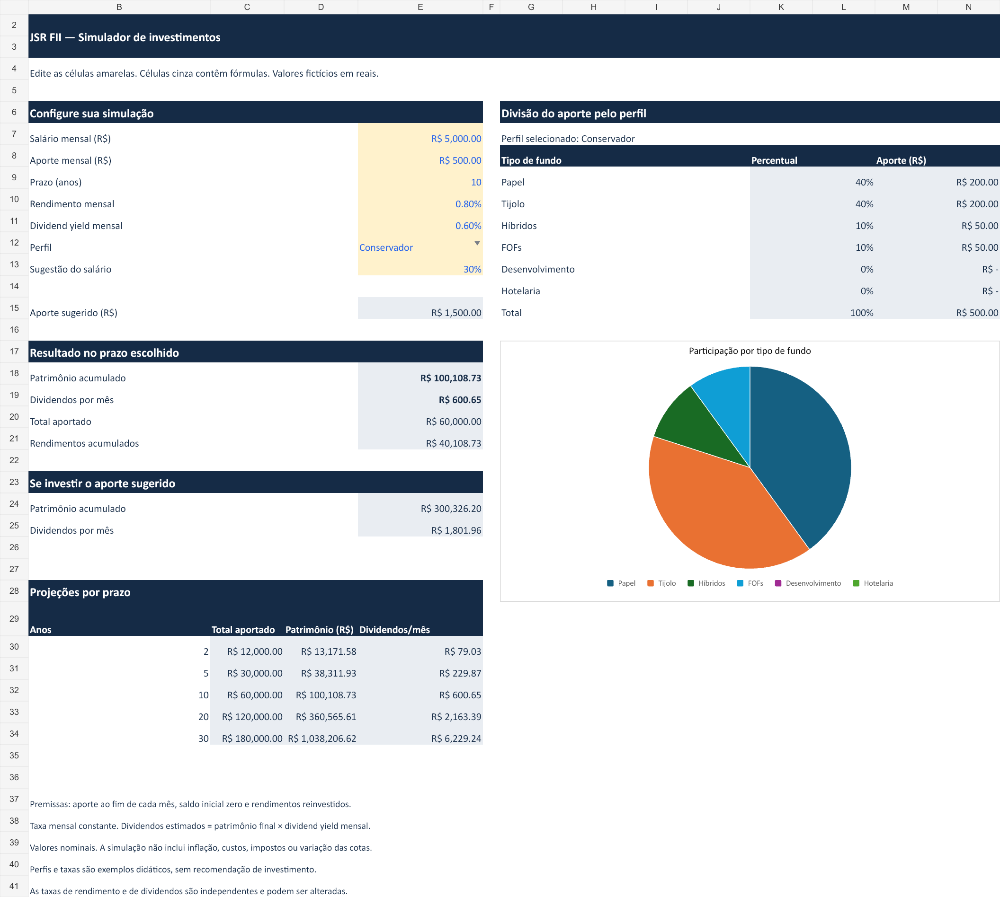
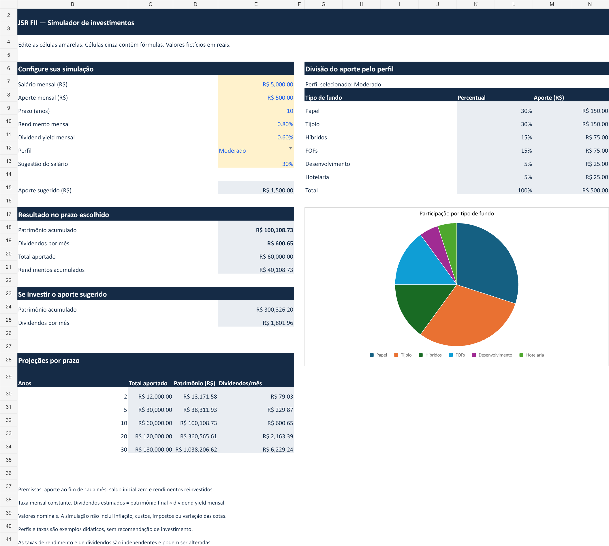

# JSR FII — Simulador de investimentos no Excel

Projeto educacional para o desafio da DIO apresentado por Felipe Aguiar (Felipão). A ferramenta calcula patrimônio com aportes mensais, estima dividendos e divide o aporte entre seis categorias de fundos conforme um perfil selecionado.

## Arquivos e uso

- `simulador-fii.xlsx`: abra no Microsoft Excel e habilite a edição, se solicitado.
- `prints/conservador.png` e `prints/moderado.png`: mesma simulação com duas distribuições diferentes.

Na aba **Simulador**, edite os campos amarelos. As células cinza contêm fórmulas e devem ser preservadas. Elas têm sinalização visual, sem bloqueio de edição por senha. Selecione o perfil em **E12** para atualizar os percentuais, os valores e o gráfico. A aba **Apoio** mantém a tabela de consulta visível para estudo.

## Perguntas de negócio

| Pergunta | Onde encontrar na aba Simulador |
| --- | --- |
| Quanto investir por mês? | E8: aporte informado. E15: sugestão calculada a partir do salário. |
| Por quantos anos? | E9: prazo informado em anos. |
| Qual a taxa de rendimento mensal? | E10: taxa usada na acumulação. |
| Quanto patrimônio será acumulado? | E18: resultado no prazo escolhido. |
| Quanto receber em dividendos mensais? | E19: estimativa sobre o patrimônio final, usando E11. |

Os cenários de **2, 5, 10, 20 e 30 anos** estão em B29:E34. A distribuição do aporte está em G8:N15.

## Como o cálculo funciona

### VF: patrimônio acumulado

No Excel em português, a fórmula de E18 é:

```excel
=VF(taxa_mensal;prazo_anos*12;-aporte;0;0)
```

- `taxa_mensal`: rendimento por mês. Exemplo: 0,80% é armazenado como 0,008.
- `prazo_anos*12`: quantidade de períodos mensais.
- `-aporte`: saída mensal de dinheiro. O sinal negativo produz um patrimônio futuro positivo.
- Primeiro `0`: saldo inicial igual a zero.
- Segundo `0`: aportes no fim de cada mês.

Os rendimentos são reinvestidos durante a acumulação. O total aportado é `aporte*prazo_anos*12`. Os rendimentos acumulados são o patrimônio menos esse total.

Nas projeções, a fórmula de D30 usa referências absolutas:

```excel
=VF($E$10;B30*12;-$E$8;0;0)
```

Ao copiar para baixo, B30 avança para o prazo seguinte e os parâmetros de aporte e taxa permanecem fixos.

### Dividendos estimados

```excel
=patrimonio*yield_mensal
```

O rendimento de acumulação em E10 e o dividend yield em E11 são parâmetros independentes. Os dividendos não são somados novamente ao patrimônio calculado por VF. A renda mostrada representa uma estimativa ao término do prazo, quando se passa a receber os dividendos.

### PROCV e chave composta

A coluna B da aba Apoio combina perfil e categoria, por exemplo `Moderado|Papel`:

```excel
=C13&"|"&D13
```

Na célula K9 do Simulador:

```excel
=PROCV(perfil&"|"&G9;Apoio!$B$7:$E$24;4;FALSO)
```

O PROCV procura a chave na primeira coluna do intervalo e retorna a quarta coluna, que contém o percentual. `FALSO` exige correspondência exata. O aporte por categoria é `aporte*K9`. Preserve nomes e chaves únicos na tabela para evitar consultas incorretas. Um perfil sem chave correspondente expõe o erro de consulta.

O arquivo XLSX armazena as funções em inglês (`FV`, `VLOOKUP`, `SUMIF`) e separadores por vírgula, conforme o padrão do formato. O Excel apresenta os nomes e separadores conforme seu idioma.

## Intervalos nomeados

Todos os nomes têm escopo de pasta de trabalho e apontam para a aba Simulador.

| Nome | Célula | Função |
| --- | --- | --- |
| salario | E7 | Salário fictício |
| aporte | E8 | Aporte mensal informado |
| prazo_anos | E9 | Prazo da simulação |
| taxa_mensal | E10 | Rendimento mensal de acumulação |
| yield_mensal | E11 | Taxa de dividendos mensais |
| perfil | E12 | Perfil selecionado |
| percentual_aporte | E13 | Fração do salário para a sugestão |
| aporte_sugerido | E15 | Salário multiplicado pela fração escolhida |
| patrimonio | E18 | Patrimônio final calculado com VF |

## Percentuais dos perfis

Percentuais fictícios criados para este projeto, sem copiar os valores da planilha do Expert. Não representam recomendações de investimento ou uma avaliação individual de risco.

| Categoria | Conservador | Moderado | Arrojado |
| --- | ---: | ---: | ---: |
| Papel | 40% | 30% | 15% |
| Tijolo | 40% | 30% | 25% |
| Híbridos | 10% | 15% | 15% |
| FOFs | 10% | 15% | 15% |
| Desenvolvimento | 0% | 5% | 20% |
| Hotelaria | 0% | 5% | 10% |
| **Total** | **100%** | **100%** | **100%** |

As categorias seguem o agrupamento didático do desafio. Não formam uma taxonomia técnica mutuamente exclusiva de todos os FIIs. As conferências em Apoio!C27:E30 mostram a soma de cada perfil e a diferença em relação a 100%.

## Exemplo e evidências

Dados fictícios: salário de R$ 5.000, aporte de R$ 500, prazo de 10 anos, rendimento de 0,80% ao mês e dividend yield de 0,60% ao mês.

| Resultado | Valor |
| --- | ---: |
| Total aportado | R$ 60.000,00 |
| Patrimônio final | R$ 100.108,73 |
| Rendimentos acumulados | R$ 40.108,73 |
| Dividendos mensais estimados | R$ 600,65 |
| Aporte sugerido (30% do salário) | R$ 1.500,00 |
| Patrimônio com o aporte sugerido | R$ 300.326,20 |

### Perfil conservador



### Perfil moderado



As imagens foram renderizadas a partir da planilha. O patrimônio permanece igual ao trocar o perfil, pois o modelo usa uma taxa de rendimento comum. A divisão do aporte e o gráfico mudam. Por exemplo, Papel passa de R$ 200 para R$ 150 e Desenvolvimento passa de zero para R$ 25.

## Personalizações em relação ao roteiro do Expert

- Identidade JSR FII, banner próprio e campos de entrada amarelos.
- Gráfico de pizza vinculado às células da distribuição.
- Simulação adicional usando 30% do salário, com percentual ajustável.
- Separação entre taxa de acumulação e taxa de dividendos.
- Exibição de total aportado e rendimentos acumulados.
- Conferência da soma de cada perfil e validações para os campos de entrada.
- Fórmulas, aba de apoio e guias mantidas acessíveis para aprendizado.

Essas diferenças se referem ao roteiro do enunciado. Não foi feita comparação célula a célula com o arquivo resolvido do Expert.

## Validação e limites

As fórmulas foram recalculadas e verificadas no mecanismo de geração, incluindo comparação de VF com uma evolução independente mês a mês. Os três perfis foram testados, com soma de 100% e alocação integral do aporte. Também foram conferidos taxa zero, prazo zero e aporte zero. A varredura final não encontrou erros de fórmula.

As imagens permitem conferir o layout das duas abas. A abertura e a interação no Microsoft Excel devem ser verificadas antes da submissão caso não tenham sido testadas no aplicativo. As validações de entrada ajudam a reduzir erros, mas não substituem a revisão de valores colados ou alterações na tabela de apoio.

O modelo usa taxas constantes e valores nominais. Não inclui inflação, impostos, taxas, variação das cotas ou rendimentos variáveis. Os resultados são simulações didáticas.

## Publicação no GitHub

Nome sugerido do repositório: **simulador-fii-excel**.

1. Crie um repositório público na sua conta.
2. Envie `README.md`, `simulador-fii.xlsx` e a pasta `prints` preservando os caminhos.
3. Abra a planilha no Excel, altere os campos amarelos e troque o perfil para conferir a atualização.
4. Confira a exibição das imagens no README.
5. Submeta o endereço do repositório, e não o link direto da planilha.

Repositório público: [JuscelinoSR/simulador-fii-excel](https://github.com/JuscelinoSR/simulador-fii-excel).

## Referência do desafio

Enunciado fornecido no desafio da DIO, apresentado por Felipe Aguiar. [Planilha resolvida disponibilizada pelo Expert](https://hermes.dio.me/files/assets/a04b81b1-8e35-4e72-aeb9-98aed8ed4403.xlsx), indicada para conferência após a construção.
